 

 

I'm a backend engineer on AI products at **OnDemand AI** and **SchoolHack AI** (part of AIREV Holding). I work mostly in Go, with some Node.js, on the parts of LLM products that sit behind the chat box: media processing, retrieval, model routing and agent orchestration.

It's team work on shared codebases, so I describe what I've worked on rather than claim whole systems. I studied materials science at NIT Calicut, which is probably why I like measuring things before I believe them.

<table>
<tr>
<td width="33%" valign="top">

**Focus** 
LLM gateways, retrieval, media pipelines, agent orchestration

</td>
<td width="33%" valign="top">

**Daily drivers** 
Go · gRPC · Redis queues · MongoDB · Qdrant

</td>
<td width="33%" valign="top">

**Scale** 
A platform with 3.4M+ active users and 165M+ queries handled

</td>
</tr>
</table>

## What I've worked on

<table>
<tr>
<td width="50%" valign="top">

### Media pipelines
Queue-driven processing for documents, audio, video and images: transcription, OCR, thumbnails and embeddings. Explicit retry rules, idempotent jobs and bounded concurrency, so one bad file can't take the workers down.

</td>
<td width="50%" valign="top">

### Retrieval
Vector search on top of model-generated embeddings: hybrid dense and keyword search, reranking behind feature flags, and separate hot and cold vector collections.

</td>
</tr>
<tr>
<td valign="top">

### LLM gateway
One interface over many model providers: streaming, tool calling, structured output, reasoning controls and OCR routing with fallbacks. Also where embeddings are generated, with request chunking, configurable dimensions and several providers.

</td>
<td valign="top">

### Agent orchestration
Planning multi-step runs across plugins, validating parameters against JSON schemas, and streaming results back as each step finishes.

</td>
</tr>
<tr>
<td valign="top">

### Storage access
Signed-URL access across several cloud storage providers, with ownership checks on every write and delete.

</td>
<td valign="top">

### Data collection
Scraping plus LLM extraction, geo search, background jobs and push notifications for a consumer app backend.

</td>
</tr>
</table>

Most of this is in private company repos, so there isn't much to show here. Happy to talk through any of it.

## How a retrieval pipeline flows

## Experience

<b>OnDemand AI</b> · Senior Software Engineer · Aug 2025 to now

 

Contributing across the platform's Go services: LLM gateway, media pipeline, storage and agent orchestration, plus custom solutions for clients.

Before that, **Software Engineer** (Mar 2024 to Jul 2025): queue-driven media processing, embeddings and search, and the services around them.

<b>SchoolHack AI</b> · Senior Software Engineer · Aug 2025 to now

 

Backend for an AI education platform with 3.4M+ active users and 165M+ queries handled.

Before that, **Software Engineer** (Jul 2023 to Jul 2025): core backend and third-party integrations while the platform scaled.

<b>Earlier</b>

 

Data analyst at a healthcare analytics company, plus backend and data internships in insurance software and energy.

## Tech stack

| | |
|---|---|
| **Languages** |     |
| **Services** |      |
| **AI** |       |
| **Infra** |     |
| **Observability** |    |

## Get in touch

I'm open to collaborating, especially on Go, retrieval and agent projects. Message me on [LinkedIn](https://linkedin.com/in/peeyush-m) or [X](https://x.com/mipeeyush).
