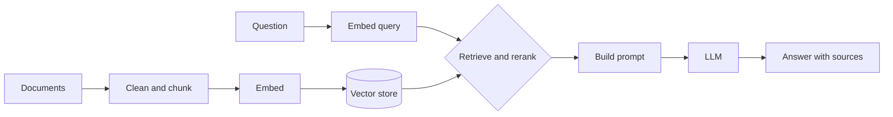

## About

I'm a backend engineer working on AI products at **OnDemand AI** and **SchoolHack AI**, both part of AIREV Holding. Most of my time goes into Go and Node.js services, retrieval (RAG), and the plumbing around LLMs.

I've built 15+ microservices from scratch and led a few client projects from first call to production. Before all this I studied materials science at NIT Calicut, which is probably why I like measuring things before I believe them.

Right now I'm working on:
- RAG systems that answer from private documents
- one clean layer over several LLM providers
- streaming and event-driven backends
- keeping latency and cost down as usage grows

## Experience

| When | Where | Highlights |
|---|---|---|
| Aug 2025 to now | **OnDemand AI**, Senior Software Engineer | Architecture for an AI platform built on RAG, plus custom solutions for clients |
| Mar 2024 to Jul 2025 | **OnDemand AI**, Software Engineer | Built a media-processing service for documents, audio, video and images. Cut vector storage by 92% with cold storage. Moved key services from Node.js to Go for lower memory use and latency |
| Aug 2025 to now | **SchoolHack AI**, Senior Software Engineer | Backend for a platform with 3.4M+ active users and 165M+ queries handled |
| Jul 2023 to Jul 2025 | **SchoolHack AI**, Software Engineer | Core backend and third-party integrations while the platform scaled |

Earlier: data analyst at a healthcare analytics company, and backend and data internships in insurance software and energy.

## What I work on

- **RAG and retrieval.** Letting an LLM answer from your own documents, with sources, and saying "I don't know" when the data isn't there.
- **Agents.** LLMs that call tools and automate repetitive work, with a person approving anything important.
- **Microservices.** gRPC, pub/sub, streaming and realtime chat, mostly in Go.
- **Integrations.** Multiple model providers and third-party APIs behind one interface.
- **Data pipelines.** Turning messy web pages and files into clean, structured data.

Most of this is in private company repos, so there isn't much to show here. Happy to talk through any of it.

## A typical RAG setup

When these systems give bad answers, the problem is usually on the left side of this diagram (chunking, retrieval, context) and not the model.

## Tech stack

| | |
|---|---|
| **AI** |         |
| **Backend** |       |
| **Data** |    |
| **Infra** |      |
| **Also** |     |

## Get in touch

I'm open to collaborating, especially on Go, RAG and agent projects. Message me on [LinkedIn](https://linkedin.com/in/peeyush-m) or [X](https://x.com/mipeeyush).
