I'm a backend engineer on AI products at **OnDemand AI** and **SchoolHack AI** (part of AIREV Holding). I work mostly in Go, on the parts of LLM products that sit behind the chat box: **RAG** (retrieval-augmented generation), media processing, model routing and **agentic AI** orchestration.

It's team work on shared codebases, so I describe what I've worked on rather than claim whole systems.

## What I work on

<table>
<tr>
<td width="50%" valign="top">

**Media pipelines** 
Queue-driven processing for documents, audio, video and images: transcription, OCR, thumbnails and embeddings. Retries that know when to give up, so one bad file can't take the workers down.

</td>
<td width="50%" valign="top">

**Retrieval (RAG)** 
Vector search over model-generated embeddings: hybrid dense and keyword search, reranking behind feature flags, and hot and cold vector collections.

</td>
</tr>
<tr>
<td valign="top">

**LLM gateway** 
One interface over many model providers: streaming, tool calling, structured output, embeddings, and OCR routing with fallbacks.

</td>
<td valign="top">

**Agent orchestration** 
Planning multi-step runs across plugins and MCP tools, validating parameters against JSON schemas, and streaming results back as each step finishes.

</td>
</tr>
<tr>
<td valign="top">

**Sandboxed agent runtime** 
Part of the team on the layer that runs coding agents in isolated containers: sandbox lifecycle, a browser tool for agents, artifact previews and deployment listings.

</td>
<td valign="top">

**Reliability** 
Tracing and metrics, dependency patching, security scans in CI, and signed-URL storage access with ownership checks.

</td>
</tr>
</table>

## How it fits together

  

<b>Walk me through the flows</b>

 

**A chat message.** The API checks auth, limits and moderation, saves the message and queues a job. A planner splits the goal into phases; steps in a phase run in parallel, with an LLM filling in parameters that are validated against the tool's schema. Tools are REST APIs, MCP servers or a sandboxed agent runtime. A gate check after each phase decides whether to move on. Events stream to the user over SSE through a relay that stores them, so a client that reconnects can replay what it missed.

**An upload.** The media service validates and stores the file, saves a record and enqueues jobs by type. Workers extract text (OCR or conversion), transcribe audio, or split video into audio plus vision analysis. Chunks are embedded through the LLM gateway as dense and keyword vectors and upserted to the vector store. Each stage reports back on a results queue, which triggers the next.

**Files from agents and plugins.** A batch of artifacts comes in and returns immediately. Each is validated, de-duplicated and classified, then gets thumbnails and a short context text that is embedded so later questions can find it. Finally it's linked to the chat session.

**A question.** The question is embedded with the same model that indexed the documents. Dense and keyword searches run and are fused, filtered to the user's own namespace. An optional rerank step reorders the passages, and the LLM answers from the top chunks with their sources.

## Experience

**OnDemand AI**, Senior Software Engineer, Aug 2025 to now. Software Engineer from Mar 2024. Contributing across the platform's Go services, plus custom solutions for clients.

**SchoolHack AI**, Senior Software Engineer, Aug 2025 to now. Software Engineer from Jul 2023. Backend for an AI education platform with 3.4M+ active users.

Earlier: data analyst at a healthcare analytics company, and backend and data internships. B.Tech in Materials Science, NIT Calicut.

## Get in touch

Open to collaborating on Go, RAG and agent projects. [LinkedIn](https://linkedin.com/in/peeyush-m) · [X](https://x.com/mipeeyush)
