 

**[Skills](#what-ive-worked-on) · [Architecture](#how-the-pieces-fit) · [Deep dives](#deep-dives) · [Experience](#experience) · [Stack](#tech-stack) · [Contact](#get-in-touch)**

 

I'm a backend engineer on AI products at **OnDemand AI** and **SchoolHack AI** (part of AIREV Holding). I work mostly in Go, with some Node.js, on the parts of LLM products that sit behind the chat box: **RAG** (retrieval-augmented generation), media processing, model routing and **agentic AI** orchestration.

It's team work on shared codebases, so I describe what I've worked on rather than claim whole systems. I studied materials science at NIT Calicut, which is probably why I like measuring things before I believe them.

## What I've worked on

<table>
<tr>
<td width="50%" valign="top">

### Media pipelines
Queue-driven processing for documents, audio, video and images: transcription, OCR, thumbnails and embeddings. Explicit retry rules, idempotent jobs and bounded concurrency, so one bad file can't take the workers down.

</td>
<td width="50%" valign="top">

### Retrieval (RAG)
Vector search on top of model-generated embeddings: hybrid dense and keyword search, reranking behind feature flags, and separate hot and cold vector collections.

</td>
</tr>
<tr>
<td valign="top">

### LLM gateway
One interface over many model providers: streaming, tool calling, structured output, reasoning controls and OCR routing with fallbacks. Also where embeddings are generated, with request chunking, configurable dimensions and several providers.

</td>
<td valign="top">

### Agent orchestration
Planning multi-step runs across plugins and MCP tools, validating parameters against JSON schemas, and streaming results back as each step finishes.

</td>
</tr>
<tr>
<td valign="top">

### Storage access
Signed-URL access across several cloud storage providers, with ownership checks on every write and delete.

</td>
<td valign="top">

### Data collection
Scraping plus LLM extraction, geo search, background jobs and push notifications for a consumer app backend.

</td>
</tr>
<tr>
<td valign="top">

### Sandboxed agent runtime
Part of the team on the layer that runs coding agents in isolated containers: sandbox lifecycle and expiry, a browser tool for agents, artifact previews and thumbnails, and deployment listings.

</td>
<td valign="top">

### Reliability
Tracing and metrics, dependency patching, and security scans in CI. Retries that know when to give up, and idempotent jobs.

</td>
</tr>
</table>

Most of this is in private company repos, so there isn't much to show here. Happy to talk through any of it.

## How the pieces fit

A simplified view of the kind of platform I work on. Each box is its own service, and they talk over gRPC and job queues.

 

## Deep dives

Click to expand. These are the flows behind the diagrams.

<b>What happens when someone sends a chat message</b>

 

1. The API checks auth, rate limits, the billing plan and content moderation, finds or creates the session, and refuses a second run while one is already active.
2. The message is saved and a job is queued, so heavy work stays off the request path.
3. A planner breaks the goal into **phases**. Steps in a phase run in parallel and respect their dependencies. An LLM fills in each step's parameters, which are validated against the tool's JSON schema.
4. Steps call tools: REST APIs described by OpenAPI, **MCP** servers, or a sandboxed agent runtime. If a tool needs credentials or a clarification, the run pauses and resumes later.
5. After each phase, a gate check compares the output against its exit criteria and carries variables forward.
6. Events stream to the user over SSE through a relay that numbers and stores them, so a client that reconnects can replay what it missed.
7. Usage and billing are recorded asynchronously.

<b>What happens when someone uploads a file or pastes a link</b>

 

1. The media service validates the request, applies rate and usage limits, and stores the file (or checks the URL or YouTube link).
2. It saves a media record and publishes an event, then enqueues the right job by type: documents for text extraction, audio and video for audio extraction, images for transcription.
3. Workers pick up each stage. Documents go through OCR or conversion, then chunking. Audio goes to an async speech-to-text provider that calls back with the result. Video is split into an audio track plus a parallel vision analysis.
4. Chunks are embedded through the LLM gateway, as dense vectors plus BM25 sparse vectors for hybrid search, and upserted to the vector store.
5. Each stage reports back on a results queue, which triggers the next stage. A final event marks the media ready and notifies the chat.

<b>What happens when an agent or plugin produces files</b>

 

1. The caller sends a batch of artifacts (app, code, document, image and so on) with their URLs and the session they belong to. The call returns immediately and the work continues in the background.
2. The media service validates each artifact, skips duplicates and classifies it. Bad artifacts come back as failures without failing the whole batch.
3. It saves a media record, then generates thumbnails and previews where they make sense. A failed thumbnail is cosmetic and doesn't fail the artifact.
4. A short context text (name, description, tags) is built, embedded and indexed so later questions can find the artifact.
5. The artifact is linked to the chat session and the UI is told it's ready.

<b>How retrieval answers a question</b>

 

1. The question is embedded with the same model that indexed the documents.
2. The vector store runs dense and BM25 sparse searches and fuses the results (hybrid search), filtered to the user's own namespace. If the namespace is in cold storage, it's restored first.
3. An optional rerank step, controlled by a feature flag, has an LLM score the passages. If it fails, the original search order is kept.
4. The top chunks come back with their sources, and the LLM answers from them.

## Experience

<b>OnDemand AI</b> · Senior Software Engineer · Aug 2025 to now

 

Contributing across the platform's Go services: LLM gateway, media pipeline, storage, agent orchestration and the sandboxed agent runtime, plus custom solutions for clients.

Before that, **Software Engineer** (Mar 2024 to Jul 2025): queue-driven media processing, embeddings and search, and the services around them.

<b>SchoolHack AI</b> · Senior Software Engineer · Aug 2025 to now

 

Backend for an AI education platform with 3.4M+ active users and 165M+ queries handled.

Before that, **Software Engineer** (Jul 2023 to Jul 2025): core backend and third-party integrations while the platform scaled.

<b>Earlier</b>

 

Data analyst at a healthcare analytics company, plus backend and data internships in insurance software and energy.

## Tech stack

| | |
|---|---|
| **Languages** |     |
| **GenAI** |         |
| **Retrieval** |      |
| **Services** |        |
| **Infra** |     |
| **Observability** |    |

## Get in touch

I'm open to collaborating, especially on Go, RAG and agent projects. Message me on [LinkedIn](https://linkedin.com/in/peeyush-m) or [X](https://x.com/mipeeyush).
